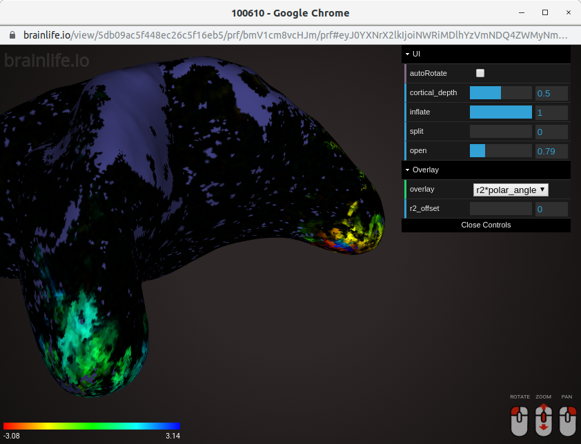

<p align="center">
  
</p>

<h1 align="center">pRFLife mrTools</h1>

<p align="center">
  Population receptive field (pRF) maps (polar angle, eccentricity, receptive field width and variance explained) from a BOLD time series and its stimulus image, fitted with mrTools.
</p>

<p align="center">
  <a href="https://github.com/brainlife/abcd-spec"></a>
  <a href="https://doi.org/10.25663/bl.app.31"></a>
  <a href="LICENSE"></a>
</p>

## At a glance

<!-- brainlife-app:begin (generated from the App manifest; edit the manifest, not this block) -->

> **Fits population receptive field (pRF) models to BOLD time series and a stimulus image with mrTools, producing polar angle, eccentricity, receptive field width and variance-explained maps.**

This app will compute a population receptive field (i.e. pRF) analysis on a given time series. Inputs needed include: a time series nifti, a stimulus nifti, the measurements of the visual stimulus in space (stimimageunits), and dimensions of a mask (mask; optional). Outputs include: x.nii, y.nii, rfWidth.nii and r2.nii. Please see http://gru.stanford.edu/doku.php/mrTools/tutorialsprf for more detail.

| | |
|---|---|
| **Inputs** | `neuro/func/task` · `neuro/stimulus` · `neuro/freesurfer` |
| **Outputs** | `neuro/prf` |
| **Container** | `brainlife/freesurfer_on_mcr:6.0.0` |
| **Resources** | 4 CPUs · 120 GB memory · 24 h walltime |
| **Requires** | `FREESURFER_LICENSE` |
| **Run it** | [doi.org/10.25663/bl.app.31](https://doi.org/10.25663/bl.app.31) |

#### Inputs

| Input | Datatype | Required | Description |
|---|---|---|---|
| `bold` | `neuro/func/task` | yes | BOLD fMRI time series from a retinotopic mapping experiment. |
| `stimimage` | `neuro/stimulus` | yes | Stimulus aperture image (NIfTI) shown during the BOLD run, as in the HCP retinotopy datasets. Should have one frame per BOLD volume. |
| `freesurfer` | `neuro/freesurfer` | yes | Freesurfer output used to create mask for visual cortex |

#### Outputs

| Output | Datatype | Description |
|---|---|---|
| `prf` | `neuro/prf` | pRF maps (polarAngle, eccentricity, rfWidth and r2 NIfTI images) plus FreeSurfer white, pial, sphere and inflated surfaces as VTK for visualisation. |

<details>
<summary><b>Parameters</b> (4)</summary>

| Parameter | Type | Default | Description |
|---|---|---|---|
| `visual_angle_width` | number | `16` | (in degree) full visual angle of the stimulation image. assumes central fixation. It should be 16 for HCP Retinotopy datasets. |
| `visual_angle_height` | number | `16` | (in degree) full visual angle of the stimulation image. assumes central fixation. It should be 16 for HCP Retinotopy datasets. |
| `frameperiod` | number | `1` | (in seconds) the time for each volume of the BOLD time series (typically the TR) |
| `prefitOnly` | boolean | `false` | Only do the grid search that finds approximately good parameters for the model and will not optimize with the nonlinear search. This will speed up the program but will not produce optimized fits. Nonetheless it should be good enough for debugging. |

</details>

<!-- brainlife-app:end -->

## Running the App

### On brainlife.io

Open the App at [doi.org/10.25663/bl.app.31](https://doi.org/10.25663/bl.app.31), choose a BOLD time series from a retinotopic mapping run (`neuro/func/task`), the stimulus aperture image shown during it (`neuro/stimulus`, as in the HCP retinotopy datasets) and the subject's `neuro/freesurfer` output, set the parameters and press **Execute**. The pRF maps are archived as a `neuro/prf` dataset.

- `frameperiod`: time of each BOLD volume in seconds (typically the TR).
- `visual_angle_width`, `visual_angle_height`: full visual angle of the stimulus image in degrees, assuming central fixation (16 for the HCP retinotopy datasets).
- `prefitOnly`: run only the grid search that finds approximately good parameters, without the nonlinear optimisation. Faster, and good enough for debugging, but the fits are not optimised.

See the [mrTools pRF tutorial](http://gru.stanford.edu/doku.php/mrTools/tutorialsprf) for details of the model.

### Locally

You need [Singularity/Apptainer](https://apptainer.org/), [`jq`](https://jqlang.github.io/jq/) and a [FreeSurfer license](https://surfer.nmr.mgh.harvard.edu/registration.html). The App runs FreeSurfer 6.0.0 (`brainlife/freesurfer_on_mcr:6.0.0`), FSL 5.0.9 (`brainlife/fsl:5.0.9`) and the compiled MATLAB code (`brainlife/mcr:r2019a`). A full fit can need a large amount of memory and many hours.

1. Clone this repository.
2. Create `config.json` with the paths to your inputs and the parameters (see `config.json.sample`):

   ```json
   {
       "bold": "testdata/bold.nii.gz",
       "stimimage": "testdata/stim.nii.gz",
       "freesurfer": "testdata/freesurfer/output",
       "frameperiod": 1.537,
       "visual_angle_width": 16,
       "visual_angle_height": 11.381,
       "prefitOnly": true
   }
   ```

3. Export your license and run the App:

   ```bash
   export FREESURFER_LICENSE="$(cat ~/freesurfer/license.txt)"
   ./main
   ```

`main` symlinks the BOLD and stimulus images into the working directory, because mrTools decompresses `.nii.gz` inputs next to the original file. It then builds a fitting mask from a FreeSurfer `aparc+aseg` label resampled to the BOLD grid with FSL `flirt`, and runs `pRFLife.m`.

## Outputs

```text
prf/
├── polarAngle.nii.gz
├── eccentricity.nii.gz
├── rfWidth.nii.gz
├── r2.nii.gz            variance explained
└── surfaces/            FreeSurfer white, pial, sphere and inflated surfaces (lh/rh, VTK) for visualisation
```

## Troubleshooting

- **`output missing`**: the fit did not write `prf/r2.nii.gz`. Check the logs, and make sure the stimulus image has one frame per BOLD volume.
- **FreeSurfer license errors**: set the `FREESURFER_LICENSE` environment variable (brainlife.io provides it automatically).

## Citing

> [!TIP]
> If you use this App in your work, please cite the App, the software it builds on and brainlife.io (below). GitHub's **Cite this repository** button gives the App citation in APA and BibTeX.

- pRFLife mrTools. brainlife.io App. [doi:10.25663/bl.app.31](https://doi.org/10.25663/bl.app.31)
- Fischl. FreeSurfer. *NeuroImage* 62:774-781 (2012). [doi:10.1016/j.neuroimage.2012.01.021](https://doi.org/10.1016/j.neuroimage.2012.01.021)
- Jenkinson et al. FSL. *NeuroImage* 62:782-790 (2012). [doi:10.1016/j.neuroimage.2011.09.015](https://doi.org/10.1016/j.neuroimage.2011.09.015)
- Hayashi S, Caron BA, Heinsfeld AS, et al. brainlife.io: a decentralized and open-source cloud platform to support neuroscience research. *Nature Methods* 21:809–813 (2024). [doi:10.1038/s41592-024-02237-2](https://doi.org/10.1038/s41592-024-02237-2)
- Avesani P, McPherson B, Hayashi S, et al. The open diffusion data derivatives, brain data upcycling via integrated publishing of derivatives and reproducible open cloud services. *Scientific Data* 6:69 (2019). [doi:10.1038/s41597-019-0073-y](https://doi.org/10.1038/s41597-019-0073-y)

## Authors

- Justin Gardner

**Contributors:** Soichi Hayashi

## Funding

[](https://wellcome.org/)
[](https://reporter.nih.gov/project-details/11261037)
[](https://reporter.nih.gov/project-details/11411328)
[](https://reporter.nih.gov/project-details/10262925)
[](https://reporter.nih.gov/project-details/10428625)
[](https://reporter.nih.gov/project-details/10460628)
[](https://reporter.nih.gov/project-details/11140284)
[](https://www.nsf.gov/awardsearch/showAward?AWD_ID=1734853)
[](https://www.nsf.gov/awardsearch/showAward?AWD_ID=2203524)
[](https://www.nsf.gov/awardsearch/showAward?AWD_ID=1636893)
[](https://www.nsf.gov/awardsearch/showAward?AWD_ID=2148729)
[](https://www.nsf.gov/awardsearch/showAward?AWD_ID=1912270)
[](https://www.nsf.gov/awardsearch/showAward?AWD_ID=2148700)
[](https://www.nsf.gov/awardsearch/showAward?AWD_ID=1916518)

<sub>brainlife.io is publicly funded, and acknowledging that support helps keep it running. This App was developed with support from Wellcome, the U.S. National Institutes of Health (including the BRAIN Initiative BRAIN CONNECTS program: The Axonal Projectome EXchange, U24NS140384, and the Center for Mesoscale Connectomics, UM1NS132207) and the U.S. National Science Foundation.</sub>

## License

[MIT](LICENSE). mrTools, FreeSurfer and FSL are distributed under their own licenses.
